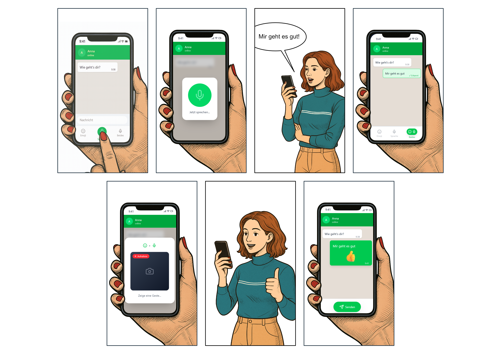

# Add-on für Nachrichtendienste - Speech to text

Ein Add-on für Nachrichtendienste, das Sprache, Gesten und Mimik erkennt und in Text + Emojis übersetzt – für barrierefreie, intuitive Kommunikation.

## Projektziel
Es soll ein multimodales Eingabe-Add-on entwickelt werden, das es Nutzern mit eingeschränkter Handmotorik oder wenig Lust zu tippen ermöglicht, Messenger-Nachrichten schnell und emotional ausdrucksstark zu verfassen.

## AMITUDE-Beschreibung
**(A):** Ein Add-on für Nachrichtendienste um **(E):** soziale Interaktionen via Messenger zu pflegen, wenn **(U):** der User nicht die Tastatur verwenden möchte. Ihren Nutzen, findet dieses Add-on auf Geräten, wie einem **(D):** Laptop, Tablet und Handy, welche mit einer **(M):** Kamera und einem Mikrofon ausgestattet sind. Die Funktionalität des add-ons zeigt sich durch einen **(I):** bewussten Austausch durch Mikrofon und Videoerkennung, **(T):** welche neben dem speech-to-text, die Mimik und Gesten des Users auswertet und in Emojis umwandelt.

## CROW-Analyse
| Dimension     | Description |
|---------------|-------------|
| Character     | Das Add-on soll Menschen mit körperlichen Einschränkungen, die Tastaturen nur schwer oder gar nicht bedienen können oder diese bewusst vermeiden, die Eingabe von Nachrichten erleichtern.<br> Die Nutzer:innen sind im Alltag auf digitale Kommunikation angewiesen, möchten dabei jedoch autonom und ohne fremde Hilfe agieren. Sie sind mit Smartphones und Messenger-Apps vertraut, empfinden die herkömmliche Texteingabe aufgrund ihrer körperlichen Einschränkung jedoch als anstrengend, langsam oder frustrierend.<br>Sie möchten sich, wie ihre Mitmenschen auch, über Textnachrichten und Emojis ausdrücken und kommunizieren. Dabei haben sie den Wunsch, gleichwertig, selbstbestimmt und mit der gleichen Schnelligkeit mit anderen Kommunikationspartner:innen zu interagieren. Sie bevorzugen Ausdrucksformen, die Nähe, Emotion und Persönlichkeit transportieren (z. B. Emojis), ohne zusätzlichen kognitiven oder motorischen Aufwand. Sie können sich besser über Gestik und Mimik ausdrücken. |
| Relationship  | Das Add-on arbeitet als Vermittler zwischen dem Nutzer und der Messenger-App. Es ermöglicht den Wechsel zwischen Eingabe mit Gesten und Sprache, welche dann in Text und Emojis übersetzt werden. |
| Objective     | Ermöglichung von intuitiver, barrierefreier Kommunikation über Messenger. Das System soll die Spracheingabe korrekt in Text umwandeln und passende Emojis generieren. Dadurch soll Zeit gespart und Kommunikation vereinfacht werden. |
| Where         | Das Add-on soll in Chat-Anwendungen integriert werden. Es kann auf Laptops, Tablets und Handys genutzt werden, die mit einer Kamera und einem Mikrofon ausgestattet sind. Es soll in Alltagssituationen, unterwegs, beim Multitasking sowie in ruhigen oder lauten Umgebungen eingesetzt werden. |

## Storyboard

*Storyboard vom Add-On*

## Installation
Repository klonen:

   ```bash
   git clone https://iversion.informatik.htw-dresden.de/s88129/recotext
   cd recotext